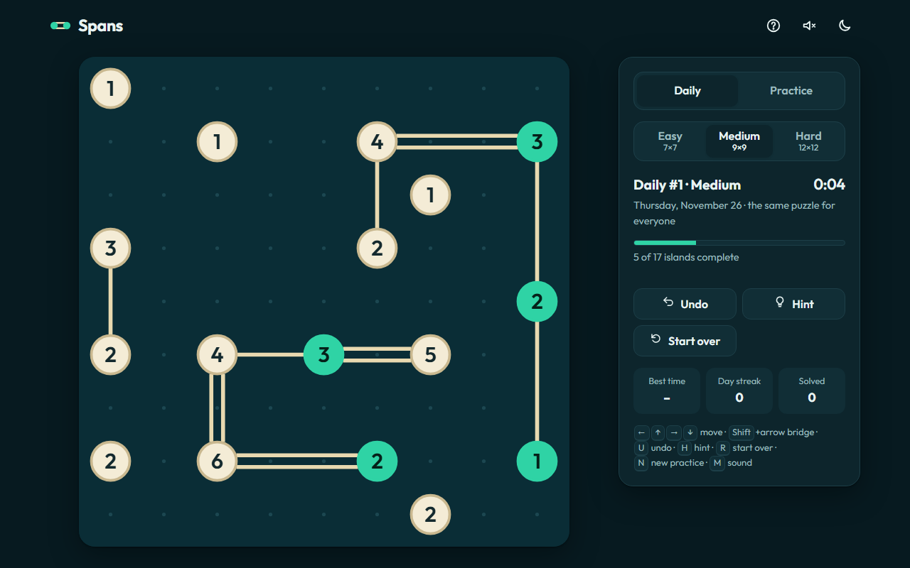

# Spans



A daily logic puzzle about islands and bridges. Each island shows how many bridges it needs. Draw bridges
straight across or up and down to the next island, at most two between the same pair, never crossing, until
every island has its number and all of them are joined into one group.

- **A new puzzle every day** in three sizes: Easy (7×7), Medium (9×9) and Hard (12×12). Daily puzzles are the same
  for everyone and change at local midnight. **Practice** gives a fresh puzzle of any size whenever you want one.
- **Exactly one solution, reached by reasoning.** Every puzzle is checked by the solver before you see it. Easy
  puzzles never need more than one step of thinking at a time; harder ones ask you to look further ahead.
- **Hints that teach.** A hint first points out a bridge that is not part of the solution, then a bridge the rules
  force from what you have built, and says why in words ("The 4 at row 2, column 5 needs two bridges east…").
- **Play your way:** drag from an island towards a neighbour, tap the water between two islands, or tap one island
  (it gets a ring) and then a neighbour it sees. Each time adds a bridge; the third time removes both. Tapping the
  water or pressing <kbd>Esc</kbd> drops the selection. Full keyboard play: arrow keys move between islands,
  <kbd>Shift</kbd>+arrow builds, <kbd>U</kbd> undo, <kbd>H</kbd> hint, <kbd>R</kbd> start over, <kbd>N</kbd> new
  practice puzzle, <kbd>M</kbd> sound (letters work while the board or the side panel has focus). A live region describes each island and each change for screen readers.
- Timer, best times, day streak and a result to copy and share. Light and dark themes, synthesised sounds (Web
  Audio), works from 320 px wide. Progress stays in this browser's `localStorage`; nothing is sent anywhere.

## How the puzzles are made

`src/generator.ts` grows a solution from one island on a seeded random generator (the daily seed is the date and
size), adds a few loops, and writes each island's number. `src/solver.ts` then solves it with the reasoning a
person uses (island counts, crossings, groups that would be cut off) and tries values only when that is not
enough. A puzzle is kept only if it has exactly one solution and its amount of trying fits its size: none at all
for Easy. `npm run puzzles` prints how long puzzles take to make and how hard they are.

The unit tests check the rules and the solver's reasoning, that every size gives the same puzzle for the same seed
with exactly one solution, that the daily puzzles of a fixed date never change, the order of hints, and that
following the hints alone, even from a wrong start, always ends in the solution. Saved data read back from the
browser is checked too, so a damaged save starts a fresh game instead of breaking one.

## Run

```sh
npm ci
npm run dev      # development server
npm test         # unit tests
npm run lint     # oxlint
npm run build    # type-check and build to dist/
```

Requires Node 22.18 or a later 22.x, Node 24, or Node 26 and later.

## Licence

MIT, © 2026 iSquare Labs.
